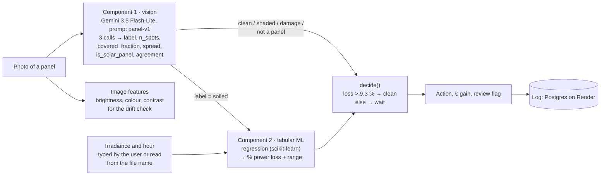

# Group Assignment Report

- **Team** (Blackboard group name): Group 8
- **Section**: BBADBA 5B
- **App URL** (on Render): https://solar-triage.onrender.com
- **Final commit** (tag `final`):

## Business case

**Who uses it.** The maintenance manager of an operations and maintenance (O&M) company that runs several medium or large solar plants in southern Spain. From a photo of a panel, they decide whether to clean it, repair it or do nothing. The app decides per photo; it does not prioritise between panels or plants.

**What happens today (baseline).** Panels are cleaned on a fixed schedule, whether they need it or not, or the company reacts when production drops: monitoring shows that output is falling, but not why or on which panel, so someone has to go and check. In the evaluation the baseline is "wait for the scheduled cleaning"; we also compare against "always clean".

**Why it is useful.** From one photo it tells apart dirt, shade and damage, which are fixed differently: cleaning does not fix shade, and a crack needs a technician for safety and warranty reasons. In southern Spain, dust, calima (Saharan dust haze) and rain-free summers make dirt a real problem.

**Success metric.** Share of correct decisions on 45 cases against the baseline (the app 67%, "wait" 42%, "always clean" 31%); undetected damage, with a target of 0 (the app caught 5 of 5); and unnecessary cleanings.

**Value in euros.** Cleaning pays off when the energy lost until the next scheduled cleaning is worth more than the cleaning. Our assumptions: cleaning costs €0.09 per m², 30 days to the next cleaning, 21%-efficient panels, and energy at €0.0325 per kWh. Cleaning pays off above a **9.3% loss**. Sensitivity: 8.3–10.2% depending on the energy price; 18.7% with 15 days to the next cleaning and 4.7% with 60. For scale, a 50 MW plant losing 5% loses about €380 a day. The app costs about €20 a month (see Cost and latency).

## Architecture

**One request, step by step** (`pipeline.run()`):

1. The user uploads a photo (optionally with irradiance 0–1 and hour 0–24). Six numbers describing the image are computed for the drift check.
2. **Component 1** (`vision.py`) sends the photo to Gemini three times: a main answer at temperature 0 and two votes at 0.8. It returns JSON with `label` (clean / soiled / shaded / visible_damage), `n_spots`, `covered_fraction`, `spread` and `is_solar_panel`. `agreement` is the share of the three answers that match the main label.
3. **Component 2** (`component2.py`) runs only when the label is `soiled`, because it was trained only on soiling losses. It adds irradiance and hour (0.5 and 12:00 if unknown, and the answer says so) and predicts the % power loss with a range that covers 80% of its test errors.
4. **`decide()`** turns both outputs into an action: `out_of_scope`, `technician` (damage), `check_shade`, `no_action`, or, for soiled panels, `clean` above the 9.3% break-even (`economics.py`) and `wait` below. It also sets the review flag.
5. The app shows the decision, latency and cost, logs the request and asks for 👍/👎.

**Why these models.** Component 1 is Gemini because it analyses images without training a vision model. A YOLO model would have needed photos with dirt, shade and damage marked with boxes, which we did not have; the Roboflow datasets are loose internet photos with no measured power loss, and a local vision model would not fit in Render's 512 MB free plan. In one answer Gemini classifies the panel, says whether the photo shows a panel at all, and returns numbers (spots, % covered) that are exactly component 2's input. Flash-Lite is the cheapest and fastest Gemini model, and we pin the model and prompt versions so results can be repeated. Its drawbacks are latency, a daily quota on an external API, and confident mistakes on nearly clean panels.

Component 2 is a regression because Gemini cannot say *how much* energy a panel loses, and we need a percentage to compare with the 9.3% break-even; DeepSolarEye gives the measured loss as a continuous number. We compared a mean baseline, ridge, random forest and gradient boosting, with and without Gemini's features, and chose **ridge** for its decision accuracy in day-by-day cross-validation (0.69, the best). The tree models had a slightly lower test error (about 16 vs 17 points) but did worse across days, and with seven inputs a simple model is enough and easy to explain.

**What we reused.** No code was copied from assignments 1–3. `app.py`, `pipeline.py`, `monitor.py`, `evaluate.py`, `logbook.py`, `check.py`, `main.py` and `env.py` come from the course template and were adapted; `vision.py`, `component2.py`, `economics.py` and `tools/` were written for this project by Lucía. We reused ideas from Lucía's assignments: a linear model on tabular data compared against a reference (assignment 1, component 2); choosing a threshold by the cost of being wrong rather than by accuracy (assignment 2, the 9.3% threshold); and evaluating with hand-written cases by kind, with the system allowed to say "not a panel" or "a person will check" instead of guessing (assignment 3).

## Data

**Component 1** is not trained: it receives a photo and returns a structured description.

**Component 2** is trained on 1,000 photos from DeepSolarEye (Mehta et al., WACV 2018, CC BY-NC-SA, https://deep-solar-eye.github.io). Each photo comes with its measured power loss, irradiance and time. Gemini described all 1,000 photos, and those descriptions plus the context are the model's inputs. We split by day: 768 photos for training and 232 for testing (27–30 June 2017), so test photos come from days the model never saw. Only the labels are in the repository (`data/deepsolareye_gemini.csv`); the photos must be downloaded from the dataset's site. The non-commercial licence is fine for coursework, but a real product would need another dataset or permission.

**Evaluation and monitoring sets.**
- 45 end-to-end cases (5.9 MB): 23 DeepSolarEye photos and 22 from Flickr and Wikimedia Commons under CC BY 2.0, CC BY-SA 2.0 or CC BY-SA 4.0, with author, licence and link in `eval/inputs/cases/SOURCES.md`.
- 40 reference photos (812 KB) for the drift check, all from DeepSolarEye.
- 15 shifted photos (228 KB) for the drift demo: DeepSolarEye photos altered on purpose.

**Personal data.** The images show panels, roofs and landscapes. We reviewed the 22 non-DeepSolarEye photos: none shows an identifiable face or a legible number plate (two show distant, unidentifiable people or vehicles). The log stores only the image's size and type, never the photo or its file name. Two things happen outside the log: the photo is sent to Gemini to be analysed (on the free tier Google may use it to improve its products, on the paid tier it does not), and Gradio keeps a temporary copy that is deleted after one hour. We found no personal data in our inputs or logs.

## Evaluation

### Components

**Component 1 – Gemini.** Metric: accuracy, precision and recall of the "soiled" label against the measured loss (a panel truly needs cleaning above 9.3%), on 1,000 DeepSolarEye photos with one call per photo at temperature 0. Result: **accuracy 71.4%, precision 0.73, recall 0.81** (`models/component1_report.json`).

|  | Gemini: not soiled | Gemini: soiled |
|---|---|---|
| Real loss < 9.3% (409 photos) | 236 ✅ | 173 ❌ |
| Real loss > 9.3% (591 photos) | 113 ❌ | 478 ✅ |

The dirtier the panel, the better Gemini detects it: it says "soiled" for 40% of photos with 0–5% loss and 90% of those with 50–100%. Its main weakness is calling 42% of nearly clean panels (173 of 409) soiled, the same failure we see end to end.

**Component 2 – ridge regression.** Metric: mean absolute error (MAE) in points of % loss, on 232 photos from 4 held-out days (`models/component2_report.json`).

| Features | MAE (pts) | Decision accuracy |
|---|---|---|
| None (always predict the mean) | 27.2 | 51.7% |
| Context only (irradiance, hour) | 26.0 | 51.7% |
| Gemini only | 18.2 | 51.7% |
| **Gemini + context (selected)** | **17.4** | **61.6%** |

Without Gemini's description the regression barely beats the mean; with it the error drops by about a third, so the first component is what gives the second its information. 80% of the errors are below 25.7 points, which is why the app shows a range, and the learning curve is flat after about 100 photos: more data would not help, the limit is what Gemini describes. On the test days the model makes more correct decisions than "always clean" (61.6% vs 51.7%) but does not lose less money (regret €0.028 vs €0.026 per m²); in cross-validation it does (€0.018 vs €0.021).

### End to end

We wrote 45 cases in `eval/cases.csv`: 17 normal, 18 hard, 5 review and 5 out of scope. Each has the expected action from the app's fixed list.

- **23 DeepSolarEye photos** from the test days. The expected action comes from the measured loss, not our opinion: `clean` above 9.3%, `wait` below. Clean panels are normal cases; borderline losses, low light and dusk are hard.
- **22 licensed photos from other sources.** We set the expected action by looking at each photo: damage goes to `technician` and must be reviewed, shade to `check_shade`, and look-alikes (a solar water heater, a glass facade, a greenhouse) are `out_of_scope`. Real-world panels are marked hard because they come from other cameras and the drift check flags them.

Two examples: **c24**, shattered glass, expected `technician` with review, and the app got it right. **c01**, a clean DeepSolarEye panel with a 3.6% loss, expected `wait`, but the app said `clean`.

| Kind | Cases | Product | Baseline: wait | Always clean |
|---|---|---|---|---|
| Normal | 17 | 9 | 9 | 8 |
| Hard | 18 | 12 | 10 | 6 |
| Review | 5 | 5 | 0 | 0 |
| Out of scope | 5 | 4 | 0 | 0 |
| **Total** | **45** | **30 (67%)** | **19 (42%)** | **14 (31%)** |

The product beats today's practice mainly where a calendar is blind: damage (5 of 5) and photos that are not panels (4 of 5). It never missed a panel that needed cleaning (14 of 14). On normal cases it only ties the baseline, because it orders cleanings for nearly clean panels. Outputs are actions, not free text, so they are compared directly and no LLM judge is needed; `no_action` and `wait` count as the same decision.

### Cost and latency

| Component | Tokens | € per photo | Seconds |
|---|---|---|---|
| 1 – Gemini (3 calls) | ~4,100 (~1,370 per call) | 0.00136 | ~3.3 |
| 2 – Ridge | 0 | ~0 | ~0.001 |
| **Total** | **~4,100** | **0.00136** | **median 13.5 (evaluation)** |

At the business-case volume of 500 photos a day, that is about €0.68 a day, **around €20 a month**, negligible next to the decision it supports: for a panel losing 25%, cleaning gains about €0.15 per m² before the next scheduled cleaning.

Almost all the cost and time come from Gemini. It needs about 3.3 s, but the evaluation's median was 13.5 s (maximum 58 s). The evaluation ran locally, so the gap comes from Gemini's free tier: requests sent too fast get a 429 (too many requests) and our code retries after 5, 10 or 20 s. Separately, the app on Render's free plan sleeps when idle, and the first request after a pause takes about 50 s. That is acceptable for a manager who checks panels a few times a day. One Gemini call instead of three would be faster and cheaper, but we would lose the confidence measure that decides which cases a person reviews.

## Operations

**What we log.** Every request is one record (`logbook.py`) in a Postgres database on Render (the app's disk is wiped on every restart), or in `logs/` locally:

| Field | Content |
|---|---|
| `id`, `timestamp` | Request id and UTC time |
| `input_summary` | Size and type only, e.g. `image 1024x768 px, jpg`. Never the photo or its file name |
| `features` | Brightness, mean R/G/B, yellowness, contrast, and Gemini's `agreement` |
| `outputs` | Component 1's answer and votes, component 2's loss and range, context, action, decision, time per component |
| `versions` | `gemini-3.5-flash-lite/panel-v1`, `regression-v1` |
| `review`, `latency_s`, `tokens`, `cost_eur` | Review flag, seconds, Gemini tokens, euros |
| feedback | Request id, time and +1 / −1 |

**Quality signals** (Monitoring tab, per hour): share sent to review, share of 👎, mean Gemini agreement, share with Gemini unavailable, and share of "clean it" decisions.

**Drift check.** The reference set is 40 normal DeepSolarEye photos spread over all days (`eval/reference.csv`). Over the last 100 requests (silent with fewer than 20), the app computes each feature's PSI against the reference, with 5 quantile bins and Laplace smoothing (+1 photo per bin). An alert fires when a PSI is above **0.25**, the usual level for a significant shift, **and** above twice the PSI expected by chance for those sample sizes, (bins − 1)·(1/n_ref + 1/n_live). With small samples chance alone gives about 0.3, so this second rule is what keeps false alarms down: on 200 random batches of 20 normal photos, the alert fired 3% of the time. We accept a slower alert in exchange, because missing a shift matters: calima, darker photos or a switch to drone cameras would change what Gemini sees, and our evaluation would no longer hold.

**Drift demo** (`main.py drift-demo`). 15 DeepSolarEye photos changed on purpose, 5 of each: darker (dusk or a worse camera), blended with dusty orange (calima) and low contrast (fog or a dirty lens).

| Feature | Normal cases (17) | Shifted (15) |
|---|---|---|
| brightness | 0.293 | 0.471 |
| mean_r | 0.293 | 0.569 |
| mean_g | 0.293 | 0.471 |
| mean_b | 0.293 | **1.664 ⚠** |
| yellowness | 0.618 | **1.664 ⚠** |
| contrast | 0.648 | **1.664 ⚠** |
| agreement (Gemini) | 0.000 | 0.146 |
| threshold | 0.671 (0.676 for agreement) | 0.733 (0.738 for agreement) |

The alert stays quiet on normal cases and fires on the shifted ones. Gemini's agreement barely moves, so its confidence alone would not reveal the shift; the image features do. Two limits: on normal cases `contrast` came close (0.648 vs 0.671), because those 17 photos come only from the test days and show fewer lighting conditions than the reference; and each shift on its own (5 photos) did not fire the alert, so small or early changes go unnoticed until enough photos arrive.

**👎 alert.** Fires when more than 40% of the last 20+ rated requests are 👎. The product was wrong in about a third of the evaluation cases, so 40% reacts only to feedback clearly worse than in testing. It is provisional and should be tuned in the pilot, and since many users will not rate answers, we read it together with the other signals.

## Failures

The product failed on 15 of the 45 cases. All 15 start at component 1 (Gemini), and in most of them component 2 then amplifies the error.

| Cause | Cases | Count |
|---|---|---|
| Nearly clean panel seen as soiled | c01–c07, c20, c21, c23, c37 | 11 |
| Shadow mistaken for dirt (expected: check shade) | c41, c42 | 2 |
| Polycrystalline texture mistaken for stains | c38 | 1 |
| Solar water heater taken for a panel | c29 | 1 |

The largest group is 11 of 15 failures. Their true loss is below 9.3% (0.3% to 9.2% on the DeepSolarEye photos), so the right action was to wait. Gemini reports only 1–5% of the panel covered, yet labels it "soiled", and the loss model turns that into an estimated loss of 17–31%: an unnecessary cleaning order. This costs money but does not put panels at risk. Only one of the 11 (c23) went to a person, because Gemini's votes disagreed.

**What we would fix first:** this group. We would add examples of nearly clean panels to Gemini's prompt, add a "lightly soiled" level, and send a case to a person when Gemini says "soiled" with 5% coverage or less. Fixing these 11 would lift accuracy from 67% to up to 91%. The other 4 can wait: they need a clearer definition of "shaded" in the prompt (the label exists, but Gemini chose "soiled") and a stricter check that the image is a PV panel.

## Decision

**Which cases go to a person.** Visible damage, always; cases where Gemini's three answers have no majority; an "unknown" answer; and Gemini unavailable.

**How many a day.** Of the 45 test cases, 7 go to a person (16%): the 5 damage cases plus c23 and c34. Without the damage cases, chosen on purpose, it is 2 of 40 (5%). Assuming 500 photos a day (a sample of areas across the plants), that is about 25 cases a day, plus damage.

**Evidence in favour.** Right in 30 of 45 cases (67%) versus 42% and 31%; damage 5 of 5 and panels that needed cleaning 14 of 14; about €0.00136 and 13.5 s per photo.

**Evidence against.** 11 of the 15 mistakes are nearly clean panels sent to cleaning, and only one reached a person, because Gemini is confidently wrong. In the 33 dirt cases the advantage over "wait" is small (64% vs 58%). In euros per m², on the test days the model does not beat "always clean" (0.0282 vs 0.0259), although it does in cross-validation (0.0182 vs 0.0208). The dataset photos are small (192×192 pixels) and non-commercial; real plant and drone photos would look different.

**Verdict: go with conditions.**
- Extra review: if Gemini says "soiled" with 5% coverage or less, a person decides. In the 1,000 labelled photos that is 34%, and in 42% of those waiting was right. At 500 photos a day this could mean up to about 170 cases, a rough maximum because those photos are not real traffic.
- Improve Gemini: examples of nearly clean panels in the prompt and a "slightly dirty" level.
- Pilot at one plant, with a person deciding in parallel. Full "go" if the pilot shows fewer unnecessary cleanings than "wait" and no missed damage.

## How to run it

- **Key:** only `GEMINI_API_KEY` (free at <https://aistudio.google.com/apikey>). Copy `.env.example` to `.env` and paste the key.
- **No download needed:** the trained model (`models/component2.joblib`), the 45 evaluation photos, and the reference and shifted photos are in the repo. The 1,000 DeepSolarEye training photos are only needed to retrain component 2 (`tools/train_component2.py`).
- **Run:** `uv sync`, then `uv run python app.py` (<http://127.0.0.1:7860>) and `uv run python check.py`.
- **Time and quota:** each photo makes 3 Gemini calls; `main.py evaluate` (45 cases) makes about 135 and `main.py reference` 120, which count against the free tier's daily limit. Without a key or quota the app does not crash: it answers "Component 1 unavailable" and sends the case to a person.
- **Online app:** it sleeps after 15 minutes without visits; the first request after that takes about 50 s.
- **Behind a corporate network or antivirus**, `uv sync` may fail with `invalid peer certificate`; `uv sync --system-certs` fixes it.

## AI use

We used Claude (Anthropic) as a coding assistant. Most of the code was written with it, part by part, and we reviewed and tested each part: `vision.py`, `component2.py`, `economics.py`, the scripts in `tools/`, and the changes to the template (decision rule, smoothed PSI, evaluation and monitoring). The team made the decisions: the problem and the user, the two components, the labels, the economic assumptions (30 days, 21% panels, energy price), the baseline, the review and drift thresholds, not doing the RL bonus, and the final verdict. We chose the test photos and wrote the case notes; Claude searched for licensed photos for us to choose from and built the CSV. Each member wrote their own report section. Claude checked the numbers against the result files (`eval/results.csv`, `models/component1_report.json`, `models/component2_report.json`), corrected a few facts, drafted the End to end section and this one, which we reviewed, and trimmed the report to the word limit without changing any figure. Gemini is also AI, but as a component of the product, not as help with the assignment.
