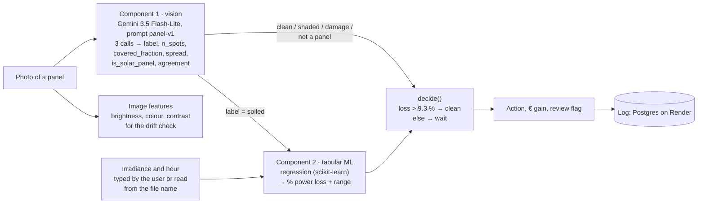
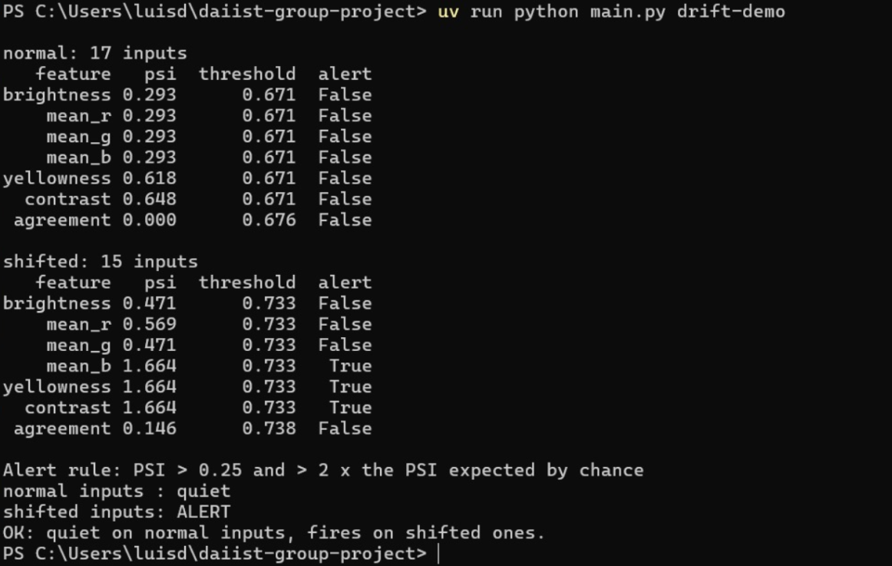

# Group Assignment Report

- **Team** (Blackboard group name):
- **Section**: [BBADBA 5A | BBADBA 5B | PPLEDBA 5A]
- **App URL** (on Render):
- **Final commit** (tag `final`):

*At most about 3,000 words, tables excluded. Members and who did what go in CONTRIBUTIONS.md.*

## Business case

1. Who uses it and what they decide

It's used by the maintenance manager of an operations and maintenance (O&M) company that manages several medium or large solar plants in southern Spain.
From a photo of a panel, they decide whether to clean it, repair it, or do nothing.
The app decides per photo. It doesn't prioritize between panels or between plants.

2. What happens today (baseline)

Panels are cleaned on a fixed schedule, whether they need it or not.
Or the company reacts when production drops. Monitoring warns that output is falling, but doesn't say why or which panel, so someone has to be sent to check.
In the evaluation, the baseline is "wait for the scheduled cleaning". We also compare against "always clean".

3. Why the app is useful

From one photo, it tells apart dirt, shade and damage, and each one is fixed differently.
Shade can't be fixed by cleaning, and a crack needs a technician for safety and warranty reasons.
In southern Spain there is dust, calima (Saharan dust haze) and rain-free summers, so dirt is a real problem.

4. How we measure success

Percentage of correct decisions across 45 cases versus the baseline: the app is right 67% of the time, "wait" 42% and "always clean" 31%.
Undetected damage. The target is 0, and the app caught 5 out of 5.
Unnecessary cleanings.

5. How much it's worth (in €)

Cleaning is worth it when the energy lost until the next cleaning is worth more than the cost of cleaning.
Team assumptions: cleaning costs €0.09 per m², there are 30 days until the next cleaning, the panels are 21% efficient, and energy is worth €0.0325 per kWh.
Result: cleaning pays off if the loss is above 9.3%.
Sensitivity: between 8.3% and 10.2% depending on the energy price; 18.7% with 15 days until cleaning and 4.7% with 60.
Example: a 50 MW plant with a 5% loss loses about €380 per day at that price.
Cost of using the app: about €0.00136 per photo. With 500 photos a day that's €0.68 a day, about €20 a month.
Limit: the app decides per photo and doesn't prioritize between plants.

## Architecture

**One request, step by step** (`pipeline.run()`):

1. The user uploads a photo in the App tab (optionally with irradiance 0–1 and hour 0–24). Six numbers that describe the image are computed for the drift check.
2. **Component 1** (`vision.py`) sends the photo to Gemini three times: one main answer at temperature 0 and two votes at temperature 0.8. It returns a JSON with `label` (clean / soiled / shaded / visible_damage), `n_spots`, `covered_fraction`, `spread` and `is_solar_panel`. `agreement` is the share of the three answers that match the main label.
3. **Component 2** (`component2.py`) runs only when the label is `soiled`, because it was trained only on soiling losses. It turns component 1's answer into numeric columns, adds irradiance and hour (0.5 and 12:00 if unknown, and the answer says so), and predicts the % power loss with a range that covers 80% of its test errors.
4. **`decide()`** turns both outputs into an action: `out_of_scope`, `technician` (damage), `check_shade`, `no_action`, or, for soiled panels, `clean` if the loss is above the 9.3% break-even from `economics.py` and `wait` otherwise. It also sets the review flag (damage, no majority among the three answers, `unknown`, or Gemini unavailable).
5. The app shows the decision, latency and cost, logs the request and asks for 👍/👎.

**Why these models.** For component 1 we chose Gemini because it analyses images without us training a vision model. A YOLO model would have needed photos with dirt, shade and damage marked with boxes, which we did not have; the Roboflow datasets are loose internet photos from other cameras, with no measured power loss. A local vision model would not fit in the 512 MB of Render's free plan either. In one call, Gemini classifies the panel into four labels, says whether the photo shows a panel at all, and returns numbers (spots, % covered) in JSON, which are exactly component 2's input. We use Flash-Lite, the cheapest and fastest Gemini model (about €0.0014 per photo for three calls), and pin the model and prompt versions so results can be repeated. Its drawbacks are the cost per image, the latency (median 13.5 s in the evaluation), a daily quota on an external API, and confident mistakes: it often sees dirt on nearly clean panels.

For component 2 we chose a tabular regression because Gemini alone cannot say *how much* energy a panel loses, and without a percentage we cannot compare it with the 9.3% break-even. DeepSolarEye gives the measured loss as a continuous number, so regression is the natural fit. We compared a mean baseline, ridge, random forest and gradient boosting, each with and without Gemini's features, and chose **ridge** for its clean/wait decision accuracy in day-by-day cross-validation (0.69, the best). Random forest and gradient boosting had a slightly lower test error (about 16 vs 17 points) but did worse across days; with only seven inputs, a simple model is enough and easy to explain. The connection pays off: without Gemini's features the error is about 26 points, no better than predicting the mean; with them it drops to about 17.

**What we reused.** No code was copied from assignments 1–3. `app.py`, `pipeline.py`, `monitor.py`, `evaluate.py`, `logbook.py`, `check.py`, `main.py` and `env.py` come from the course template and were adapted (components, decision rule, smoothed PSI, metrics). `vision.py`, `component2.py`, `economics.py` and `tools/` were written for this project by Lucía. We reused ideas from Lucía's assignments: from assignment 1, a linear model on tabular data compared against a reference model (component 2); from assignment 2, choosing a threshold by the cost of being wrong rather than by accuracy (the 9.3% euro threshold); from assignment 3, evaluating with hand-written cases by kind (normal, hard, review, out of scope) and letting the system say "not a panel" or "a person will check" instead of guessing.

## Data

**Component 1 (Gemini vision).** It is not trained: it receives a photo and returns a structured description (soiled or clean, number of spots, share of the panel covered, how the dirt is spread, and whether the image shows a solar panel).

**Component 2 (loss model).** It is trained on 1,000 photos from DeepSolarEye (Mehta et al., WACV 2018, licence CC BY-NC-SA, https://deep-solar-eye.github.io). Each photo comes with its measured power loss and the irradiance and time of the shot. Gemini described all 1,000 photos, and those descriptions plus the context are the model's inputs. We split by day: 768 photos for training and 232 for testing (27–30 June 2017), so the test photos come from days the model never saw. The photos are not in the repository, only the labels (`data/deepsolareye_gemini.csv`); they must be downloaded from the dataset's site. The "non-commercial" licence is fine for this coursework, but a real product would need another dataset or permission.

**Evaluation and monitoring sets.**
- 45 end-to-end cases (5.9 MB): 23 DeepSolarEye photos and 22 photos from Flickr and Wikimedia Commons under CC BY 2.0, CC BY-SA 2.0 or CC BY-SA 4.0. Author, licence and link for each are in `eval/inputs/cases/SOURCES.md`.
- 40 reference photos (812 KB) for the drift check, all from DeepSolarEye.
- 15 shifted photos (228 KB) for the drift demo, DeepSolarEye photos altered on purpose (for example, haze).

 **Personal data.** The images show panels, roofs and landscapes. We reviewed the 22 photos that do not come from DeepSolarEye: none shows an identifiable face or a legible number plate, although two show a shadow or distant, unidentifiable people and vehicles. The logger stores only the image's size and type (for example "image 1024x768 px, jpg"), together with the outputs, versions, time, cost and the user's thumbs up/down; it does not store the photo or its file name. Two things happen outside the log: the photo is sent to Gemini to be analysed, and Gradio keeps a temporary copy for about one hour. We found no personal data in our test inputs or in the logs.

## Evaluation

### Components

**Component 1 – Vision (Gemini).**
- Metric: accuracy, precision and recall of the "soiled" label against the real power
  loss measured in DeepSolarEye (a photo truly needs cleaning if its loss is above 9.3%)
- Test data: 1,000 DeepSolarEye photos, one Gemini call per photo at temperature 0
- Result: accuracy 71.4%, precision 0.73, recall 0.81
  (source: models/component1_report.json)

|  | Gemini: not soiled | Gemini: soiled |
|---|---|---|
| Real loss < 9.3% (409 photos) | 236 ✅ | 173 ❌ |
| Real loss > 9.3% (591 photos) | 113 ❌ | 478 ✅ |

Gemini finds 81% of the panels that really need cleaning, and the dirtier the panel,
the better it detects it: it says "soiled" for 40% of photos with 0–5% loss, but for
90% of those with 50–100% loss. Its main weakness is the opposite error: it calls
42% of nearly clean panels (173 of 409) soiled. This is the same failure we see in
the end-to-end evaluation, where 11 of the 15 errors are nearly clean panels that the
app wants to clean. Note that this evaluation uses a single call per photo, while the
app makes three and uses their agreement to send unsure cases to a person.

**Component 2 – Power-loss regression (ridge).**
- Metric: mean absolute error (MAE), in percentage points of power loss
- Test data: 232 photos from 4 held-out days, trained on 768 (see Data)
- Result: MAE 17.4 pts (source: models/component2_report.json)

| Features | MAE (pts) | Decision accuracy |
|---|---|---|
| None (always predict the mean) | 27.2 | 51.7% |
| Context only (irradiance, hour) | 26.0 | 51.7% |
| Gemini only | 18.2 | 51.7% |
| **Gemini + context (selected)** | **17.4** | **61.6%** |

Without Gemini's description, the regression barely beats predicting the average loss
(26.0 vs 27.2 pts). With it, the error drops by about a third. The first component is
what gives the second one its information.

We chose ridge over random forest (test MAE 16.3) because the choice was made on
cross-validation by day, where ridge had the best decision accuracy (0.69 vs 0.66),
not on the test set. It is also simpler to explain.

Two limitations remain. First, 80% of the errors are below 25.7 pts, which is why the
app shows a range and not a single number. Second, the learning curve is flat after
about 100 photos, so more training data would not help: the limit is what Gemini
describes. On the 4 test days, the model makes more correct decisions than "always
clean" (61.6% vs 51.7%) but does not lose less money (regret €0.028 vs €0.026 per m²).
On cross-validation it does (€0.018 vs €0.021).

### End to end

*How you wrote `eval/cases.csv` (counts by kind, two examples). Results against the baseline. Where the output is free text: the judge's rubric and your agreement with it on your own labels.*

### Cost and latency

| Component | Tokens | € per photo | Seconds |
|---|---|---|---|
| 1 – Gemini (3 calls) | ~4,100 (~1,370 per call) | 0.00136 | ~3.3 |
| 2 – Ridge | 0 | ~0 | ~0.001 |
| **Total** | **~4,100** | **0.00136** | **median 13.5 (evaluation)** |

Monthly cost at the business-case volume: 500 photos/day (about 15,000 per month)
× €0.00136 = about €0.68 per day, **around €20 per month**.

Almost all the cost and time come from Gemini. We call it three times per photo: once
at temperature 0 for the main answer and twice at 0.8, so that disagreement between the
answers tells us when Gemini is unsure. Those cases go to a person. The ridge model runs
on our server at practically no cost; only the first request takes ~1.7 s to load it.

Gemini needs about 3.3 s, but the median in the evaluation was 13.5 s (maximum 58 s).
The evaluation ran locally, not on Render, so the gap comes from Gemini's free tier:
when requests come too fast it answers 429 (too many requests), and our code waits 5,
10 or 20 s before retrying (`vision.py`). Separately, the live app on Render's free plan
sleeps when idle, and the first request after a pause takes about 50 s to wake it up.
For a maintenance manager who
checks panels a few times a day, this is acceptable. For real-time use, a paid plan
would be needed.

About €20 a month is negligible next to the decision it supports: for a panel losing 25%,
cleaning gains about €0.15 per m² before the next scheduled cleaning (`economics.py`),
many times the cost of the photo.
To make the app faster and cheaper we could call Gemini once instead of three times,
but we would lose the confidence measure that decides which cases a person reviews.

## Operations

**What we log.** Every request is one record (`logbook.py`), stored in a Postgres database on Render (the app's disk is wiped on every restart) and in `logs/` when run locally:

| Field | Content |
|---|---|
| `id`, `timestamp` | Request id and UTC time |
| `input_summary` | Size and type only, e.g. `image 1024x768 px, jpg`. Never the photo or its file name |
| `features` | Brightness, mean R/G/B, yellowness, contrast, and Gemini's `agreement` |
| `outputs` | Component 1's answer and votes, component 2's loss and range, context, action, decision, time per component |
| `versions` | `gemini-3.5-flash-lite/panel-v1`, `regression-v1` |
| `review`, `latency_s`, `tokens`, `cost_eur` | Review flag, seconds, Gemini tokens, euros |
| feedback | Request id, time and +1 / −1 |

No personal data is logged. Two caveats: the photo is sent to the Gemini API to be analysed, and Gradio keeps a temporary copy of uploaded photos on the server that is deleted after one hour.

**Quality signals over time** (Monitoring tab, per hour): share sent to review, share of 👎 among rated requests, mean Gemini agreement, share of requests where Gemini was unavailable, and share of "clean it" decisions.

**Drift check.** The reference set is 40 normal DeepSolarEye photos spread over all days (`eval/reference.csv`). For the last 100 requests (silent with fewer than 20), the app computes the PSI of each feature against the reference, with 5 quantile bins and Laplace smoothing (+1 photo per bin). An alert fires when a feature's PSI is above **0.25 and** above twice the PSI expected by chance for those sample sizes, (bins − 1)·(1/n_ref + 1/n_live), which is already about 0.3 with 40 and 20 photos. On 200 random batches of 20 normal photos, the alert fired 3% of the time.

**Drift demo** (`main.py drift-demo`). 15 DeepSolarEye photos changed on purpose, 5 of each: darker (`dark`, dusk or a worse camera), blended with dusty orange (`calima`, Saharan haze) and low contrast (`flat`, fog or a dirty lens). PSI per feature:

| Feature | Normal cases (17) | Shifted (15) |
|---|---|---|
| brightness | 0.293 | 0.471 |
| mean_r | 0.293 | 0.569 |
| mean_g | 0.293 | 0.471 |
| mean_b | 0.293 | **1.664 ⚠** |
| yellowness | 0.618 | **1.664 ⚠** |
| contrast | 0.648 | **1.664 ⚠** |
| agreement (Gemini) | 0.000 | 0.146 |
| threshold | 0.671 (0.676 for agreement) | 0.733 (0.738 for agreement) |

The alert stays quiet on normal cases and fires on the shifted ones (3 features). Gemini's agreement barely moves: on altered photos Gemini stays just as sure of itself, so its confidence alone would not reveal the shift; the image features do.

**👎 alert.** Fires when more than 40% of the last 20+ rated requests are 👎.

**Why this drift threshold.** PSI 0.25 is the usual level for a significant shift. With small samples, however, PSI is high by chance alone: with 40 reference and 20 live photos, chance already gives about 0.3. Requiring twice that value as well keeps false alarms at about 3%. We accept that trade-off because in a solar plant a missed shift matters: calima, darker photos or a switch from fixed cameras to drones would change what Gemini sees, and the evaluation results would no longer hold. The cost is that the alert needs enough photos before it can fire, so it reacts with some delay.

**What the demo tells us.** On normal cases, `contrast` reached 0.648 against a threshold of 0.671: no alert, but close. All 17 normal cases are DeepSolarEye photos from the test days (27–30 June, 9 of them from 27 June), while the reference covers 13–30 June, so they show fewer lighting conditions than the reference. A system that runs this close to its threshold could raise false alarms, so we will watch it. Each type of shift on its own (5 photos) did not fire the alert; the 15 together did. The alert detects a clear shift, but small or early changes go unnoticed until enough photos arrive.

**Why 40% 👎.** The product was wrong in about a third of the evaluation cases (67% correct). An alert at 40% does not react to the normal error rate, only to feedback clearly worse than what we measured in testing. It needs at least 20 rated requests. The threshold is provisional and should be tuned in the pilot: lower would catch problems earlier but with more noise, higher would react later. Many users will not rate answers, so the alert may never have enough data; that is why we read it together with the other signals (share sent to review, Gemini's agreement and drift).

## Failures

The product failed on 15 of the 45 cases (67% correct). All 15 start at component 1 (Gemini), and for most of them component 2 then amplifies the error.

| Cause | Cases | Count |
|---|---|---|
| Nearly clean panel seen as soiled | c01–c07, c20, c21, c23, c37 | 11 |
| Shadow mistaken for dirt (expected: check shade) | c41, c42 | 2 |
| Polycrystalline texture mistaken for stains | c38 | 1 |
| Solar water heater taken for a panel | c29 | 1 |

The largest group is 11 of 15 failures (73%). In those cases the true loss is below the 9.3% at which cleaning pays off (0.3% to 9.2% on the DeepSolarEye photos), so the correct action was to wait. Gemini reports only 1–5% of the panel covered, yet it still labels the panel "soiled", and the loss model turns that label into an estimated loss of 17–31%. The result is an unnecessary cleaning order. This costs money but does not put the panels at risk, and one of the 11 (c23) was sent to a person because Gemini's three votes disagreed.

**What we would fix first:** this group. We would add examples of nearly clean panels to Gemini's prompt, add a "lightly soiled" level, and send a case to a person when Gemini says "soiled" but reports 5% coverage or less. Fixing only these 11 would lift accuracy from 67% to up to 91% (41 of 45). The shadow and out-of-scope failures are only 4 cases, so we would handle them later, with a clearer definition of "shaded" in Gemini's prompt (the label exists, but Gemini chose "soiled") and a stricter check that the image is a PV panel.

## Decision
1. Which cases go to a person

Visible damage, always.
Cases where Gemini's three answers have no majority.
An "unknown" answer.
Gemini not available.

2. How many cases per day

Of the 45 test cases, 7 go to a person (16%): the 5 damage cases, plus c23 and c34. Without the 5 damage cases, which were chosen on purpose, it's 2 out of 40 (5%).
We assume 500 photos a day, a sample of areas across the plants. This is an assumption and can be changed.
5% is about 25 cases a day, not counting damage.

3. Evidence in favor

It's right in 30 of 45 cases (67%), versus 42% and 31%.
Damage 5/5, and panels that needed cleaning 14/14.
It costs about €0.00136 per photo and takes about 13.5 seconds.

4. Evidence against and limits

11 of the 15 mistakes are nearly clean panels that the app tells you to clean. That costs money but doesn't put the panels at risk.
Only 1 of those 15 mistakes reached a person, because Gemini is confidently wrong.
In the 33 dirt cases, the advantage over "wait" is small (64% vs 58%).
In euros per m², on the test days the model doesn't beat "always clean" (0.0282 vs 0.0259). In cross-validation it does (0.0182 vs 0.0208).
The dataset photos are small (192×192 pixels) and have a non-commercial license. A real plant and drone photos would look different.

5. Verdict: go with conditions

Extra review: if Gemini says "dirty" and 5% or less of the surface is covered, it goes to a person.
In the 1,000 labeled photos, that would be 34%. In 42% of those cases, waiting was the correct choice.
With 500 photos a day, that could be up to about 170 cases. This is a rough maximum, because those photos aren't real traffic.
Improve Gemini: add examples of nearly clean panels to the prompt, and add a "slightly dirty" level.
Pilot at one plant: a person decides in parallel, and the results are compared.
Move to a full "go": if in the pilot there are fewer unnecessary cleanings than with "wait" and no damage slips through.

## Bonus: reinforcement learning

*Delete this section if you did not do it. The loop (feedback → reward → update → behaviour), the reward and what it could reward by accident, the exploration strategy and its cost, the evidence from real logs (and which part was simulated), the risks.*

## How to run it

- **Key:** only `GEMINI_API_KEY` (free at <https://aistudio.google.com/apikey>). Roboflow and Hugging Face are not used. Copy `.env.example` to `.env` and paste the key.
- **No download needed to run the app:** the trained model (`models/component2.joblib`), the 45 evaluation photos, the reference and the shifted photos are in the repo. The 1,000 DeepSolarEye training photos are only needed to retrain component 2 (`tools/train_component2.py`), from <https://deep-solar-eye.github.io>.
- **Run:** `uv sync`, then `uv run python app.py` (<http://127.0.0.1:7860>) and `uv run python check.py`.
- **Time and quota:** each photo makes 3 Gemini calls. Gemini needs about 3.3 s, but on the free tier requests sent too fast get a 429 and are retried after 5, 10 or 20 s, so the evaluation's median was 13.5 s (see Cost and latency). `main.py evaluate` (45 cases) makes about 135 calls and `main.py reference` 120, which counts against the free tier's daily limit. If the key is missing or the quota is used up, the app does not crash: it answers "Component 1 unavailable" and sends the case to a person.
- **Online app:** it sleeps after 15 minutes without visits; the first request after that takes about 50 s.
- **Behind a corporate network or antivirus**, `uv sync` may fail with `invalid peer certificate`; `uv sync --system-certs` fixes it.

## AI use

*What you used and how, or "none".*
